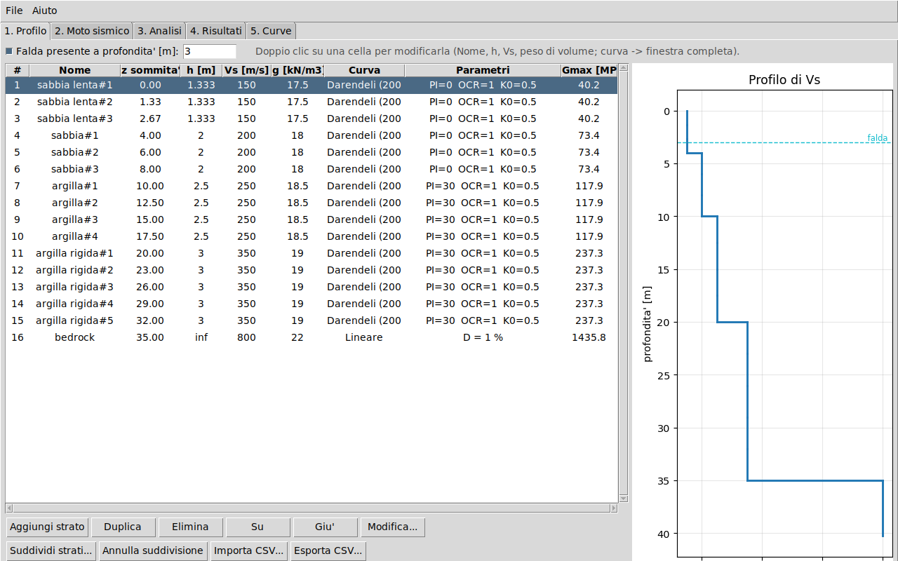
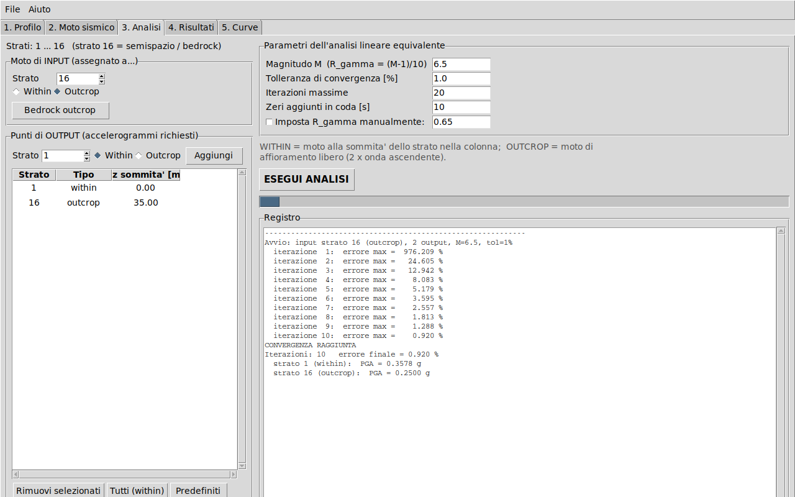
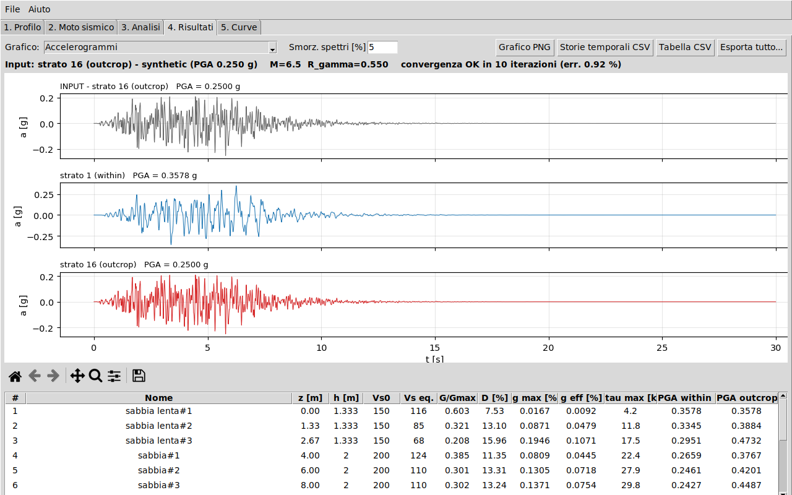

# EQL Site Response

Analisi di **risposta sismica locale 1D con metodo lineare equivalente**, con interfaccia grafica,
sullo schema di **EERA** (Bardet et al., 2000) e **STRATA** (Kottke & Rathje, 2008).
Calcola l'accelerogramma in superficie o all'altezza di qualsiasi strato, con la possibilita' di
assegnare **per ogni punto (input e output) il tipo di moto `within` oppure `outcrop`**, come nel foglio EERA.

## Installazione

Serve Python 3.9 o successivo.

```bash
pip install -r requirements.txt      # numpy, scipy, matplotlib
```

Tkinter (l'interfaccia grafica) e' incluso nell'installer di Python per Windows e macOS.
Su Linux Debian/Ubuntu: `sudo apt install python3-tk`.

## Avvio

| Sistema | Comando |
|---|---|
| Windows | doppio clic su `avvia_windows.bat` (oppure `python run_gui.py`) |
| Linux / macOS | `./avvia_linux_mac.sh` (oppure `python3 run_gui.py`) |

Per provare subito: menu **File -> Carica esempio**, poi scheda **3. Analisi** -> **ESEGUI ANALISI**.

## Guida alle schede

1. **Profilo** - tabella degli strati: nome, spessore, Vs, peso di volume, curva di degrado.
   Doppio clic su Nome / h / Vs / peso di volume per modificare la cella; doppio clic su Curva
   (o *Modifica...*) per la finestra completa. Falda opzionale (serve per la tensione efficace
   delle curve di Darendeli). *Suddividi strati...* applica il criterio h <= Vs / (n f_max).
   Import/export CSV del profilo. **L'ultima riga e' sempre il semispazio (bedrock).**
2. **Moto sismico** - apertura file (PEER NGA `.AT2`, testo/CSV a 1 colonna con dt, oppure a
   2 colonne tempo/accelerazione; unita' g, m/s2, cm/s2), generazione di un moto sintetico,
   scalatura a PGA target o per fattore, rimozione della media, grafici (storia, Fourier, spettro).
3. **Analisi** - punto di **input** (strato + within/outcrop), elenco dei punti di **output**
   (ciascuno con strato + within/outcrop), parametri: magnitudo (R_gamma = (M-1)/10, oppure
   valore manuale), tolleranza, iterazioni massime, zeri in coda. Il calcolo gira in un thread
   separato con registro delle iterazioni.
4. **Risultati** - 8 grafici (accelerogrammi, spettri di risposta, funzioni di trasferimento,
   spettri di Fourier, profili di gamma/G-Gmax/D/tau/PGA, profilo Vs, convergenza, cruscotto),
   tabella per strato, esportazione CSV/PNG o di tutto in una cartella.
5. **Curve** - anteprima di G/Gmax e D in funzione di gamma per gli strati scelti.

I progetti (profilo + moto + impostazioni) si salvano e si riaprono dal menu **File** (`.json`).





## Within e outcrop

Gli strati sono numerati da 1 (superficie) a N (semispazio).

- **Within** allo strato m: moto alla sommita' dello strato m, all'interno della colonna
  (onda ascendente + discendente, `A_m + B_m`).
- **Outcrop** allo strato m: moto che si avrebbe alla sommita' dello strato m se fosse una
  superficie libera (`2 A_m`). Una registrazione su roccia affiorante si assegna come
  **outcrop sul semispazio (strato N)**.
- Nello strato 1 within e outcrop coincidono.

## Metodo

- Onde SH in mezzo stratificato visco-elastico, nel dominio della frequenza (Kramer, 1996;
  Schnabel et al., 1972). Modulo complesso `G* = G (1 - 2 b^2 + 2 i b sqrt(1 - b^2))`.
  Le ampiezze sono rinormalizzate strato per strato: nessun overflow ad alta frequenza.
- Iterazione lineare equivalente: deformazione efficace `gamma_eff = R_gamma * gamma_max`,
  con `gamma_max` calcolata a meta' strato nel dominio del tempo; G e D vengono aggiornati
  dalle curve fino alla convergenza (errore relativo massimo su G e D < tolleranza).
- Smorzamento indipendente dalla frequenza (come nella formulazione base di EERA).
- Curve disponibili: **Darendeli (2001)** (PI, OCR, K0, tensione efficace), **iperbolica** con
  smorzamento di Masing, **tabellare** (anche da CSV a 3 colonne gamma %, G/Gmax, D %),
  **lineare** con smorzamento costante.

## Uso da script

```python
from eqlsite import *
from eqlsite.project import demo_specs, profile_from_specs

specs, falda = demo_specs()
prof = profile_from_specs(specs, falda)
N = prof.n
moto = Motion.from_file("record.AT2", units="g")        # oppure Motion.synthetic(...)
ris = EquivalentLinearAnalysis(prof).run(
    moto, Location(N, "outcrop"),
    [Location(1, "within"), Location(N, "outcrop")], magnitude=6.5)
ris.print_summary(); ris.to_csv("out.csv")
```

Vedi `examples/esempio_script.py`.

## Validazione

`python tests/test_core.py` (o `pytest tests`) verifica, fra l'altro:
strato su base rigida contro la soluzione analitica (errore ~1e-15, picco a Vs/4H);
strato con stessa impedenza del semispazio (outcrop -> superficie = 1); coincidenza di within e
outcrop in superficie; reciprocita' dei punti di input/output; stabilita' fino a 500 Hz con 30
strati; l'outcrop ricalcolato sul bedrock coincide con l'input; salvataggio/apertura progetto.

## Limiti e avvertenze

- Modello 1D, onde SH a incidenza verticale, comportamento lineare equivalente: per deformazioni
  elevate (indicativamente oltre ~1 %) o forti pressioni interstiziali servono analisi non lineari.
- Per un input assegnato come **within** a profondita' la funzione di trasferimento ha singolarita' alle
  frequenze in cui la sovrapposizione delle onde da' un nodo: il calcolo e' regolarizzato, ma
  la deconvoluzione da un punto interno va interpretata con cautela.
- Suddividi sempre gli strati (criterio h <= Vs/(5 f_max)) prima dell'analisi.
- Il programma e' uno strumento di calcolo: i risultati vanno verificati dal professionista
  (confronto con EERA/STRATA o con altri codici) prima di un uso progettuale.

## Struttura

```
run_gui.py             avvio GUI
eqlsite/core.py        motore di calcolo (profilo, curve, moto, analisi, spettri)
eqlsite/gui.py         interfaccia Tkinter
eqlsite/plots.py       grafici matplotlib
eqlsite/project.py     progetti JSON, import/export CSV, suddivisione strati
examples/              progetto, profilo e moto di esempio, script d'uso
tests/test_core.py     test di validazione
docs/                  schermate
```
